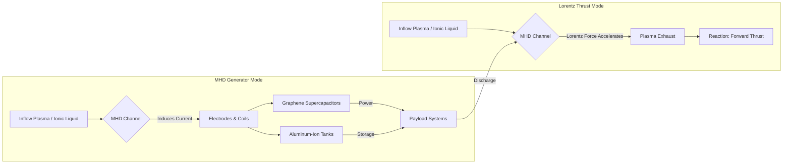

# Concept Notes (Genesis Document)

This page preserves the original brainstorm that seeded this repository --
the free-form exploration of the MHD/ionic-liquid/solar-wind concept before
it was split into a formal physics paper
([`whitepapers`](https://github.com/Overby-Industries/whitepapers)), sizing
code ([`sim/`](../sim)), and flight-control firmware ([`firmware/`](../firmware)).

It's kept as historical record and community context, not as the
authoritative technical reference -- for that, see
[`docs/physics-basis.md`](physics-basis.md) and the whitepaper it points to.
Where this document and the whitepaper disagree, the whitepaper wins.

---

## Vision

Space is not just the next frontier -- it is the shared commons for
humanity's freedom and progress. Overby Industries is pioneering
planetary-scale power and propulsion systems that merge deep-space physics
with breakthrough electrochemical engineering. The goal: practically
unlimited delta-V, so humanity can travel, settle, and thrive beyond Earth.

## Core Concept

Dual-mode ion thrusters (space + atmospheric ABEP) and MHD-Lorentz drives
powered by solar wind capture.

- Ion propulsion (NASA's Dawn mission) is already proven for deep space.
- Air-Breathing Electric Propulsion (ABEP) has been tested at ESA for
  harvesting residual atmosphere in LEO.
- Magnetosail / Electric Sail concepts (Janhunen 2004; NASA NIAC) propose
  using solar wind particles for thrust and power.

## Core Branches

**MHD-Lorentz Dynamo Drives and MHD-Fluid Dynamo Power Reactors**
- Molten salts / ionic liquids as working fluid, renewable cycle.
- Plasma generator -> electrical & thrust coupling.
- Ethical stance: closed-loop, no chemical exhaust dumped into space.

**Ionic Liquid Electrospray Engines / Dual-Mode Ion Thrusters**
- Green, non-toxic propellants (ionic salts instead of xenon/krypton).
- Atmospheric mode: electrostatic air-breathing ramjet, scooping
  atmospheric molecules (O2/N2 on Earth, CO2 on Mars) and ionizing those
  instead of carrying propellant.
- Space mode: stored ionic liquids or captured solar ions as propellant.
- NASA/ESA are already testing this in concept as Air-Breathing Electric
  Propulsion (ABEP) for LEO satellites.

**Solar Wind Capture for Electricity & Propulsion**
- Solar wind: charged particles (protons, electrons, alpha/helium)
  constantly flowing from the Sun at 400-800 km/s.
- Electric Sail (E-Sail): long charged tethers deflect solar ions ->
  propulsion from momentum exchange.
- Magnetosail / Plasma Magnet: magnetic bubble inflated with plasma to
  "scoop" solar wind and translate kinetic energy into thrust.
- Direct power conversion: solar wind plasma captured, funneled into an
  MHD generator, converted to electricity.

This means the MHD dynamo core can be an "open system": it doesn't only run
off onboard ionic liquids -- it can couple to solar wind plasma
indefinitely. Slow trickle, but a long-duration supply. (See
[`docs/physics-basis.md`](physics-basis.md) for why this is sized as a
trickle-charge source, not primary propulsion power.)

## Dual-Mode Propulsion System

- **Efficient cruise mode:** dual-mode ion thrusters sip ionic-liquid
  propellant or use captured solar wind plasma directly for long-duration
  burns.
- **Boost mode:** MHD & Lorentz drives kick in for major maneuvers, powered
  by high-discharge capacitors.

## Why This Works as a Unified System

- Propulsion is tied directly to energy generation through the MHD +
  Lorentz dynamo.
- Ionic liquids serve triple duty: safe energy storage, propellant, and
  reaction medium.
- Each miner/refiner is autonomous with its own portable powerplant --
  scalable, swarm-based operations.

## Ionic Liquid Batteries & Thermal Buffering

- Ionic liquid batteries (AlCl3-urea, BMIM-BF4-based): non-flammable,
  high-density, recyclable electrolytes.
- Graphene supercapacitors handle spikes, recharge thousands of cycles,
  reduce waste.
- Ionic liquid tanks engineered near the belly heat-shield system: instead
  of only traditional ablative ceramics, absorbed reentry heat channels
  into high-thermal-resistance ionic tanks.
- These liquids (AlCl3/urea complexes, BMIM-BF4, etc.) tolerate 200-400C+
  without boiling or vapor loss (low vapor pressure) and act as thermal
  buffers, soaking heat spikes and redistributing internally to radiators.
- A thin ablative ceramic outer hull plus liquid tanks underneath gives: an
  outer sacrificial ablative layer against reentry plasma, and an ionic
  tank buffer that absorbs and spreads heat, protecting the inner
  structure. Absorbed heat can even be partially harvested back into power
  conversion (thermoelectrics).

This gives a shuttle a triple-duty liquid tank system: propellant source
(ion electrospray thrusters), electrolyte energy storage (liquid battery
chemistry), and internal thermal shielding (reentry, high-temp ops).

## The Power Cycle, End to End

- Solar wind ions are intercepted by plasma/magnetic sails and guided into
  MHD coils.
- Electricity generated by moving plasma streams feeds ion thrusters and
  charges batteries.
- Ion thrusters can burn solar wind automatically in space for
  long-sustained flight with reduced propellant draw.
- Ionic liquid reservoirs supplement when solar flux is weak or thrust
  demand exceeds collection, double as heat absorbers during reentry or
  thermal peaks, and serve as Al-ion "batteries" for storage and
  redundancy.



## Tech Tree (Simplified)

```text
                                 +------------------------------+
                 | OVERBY INDUSTRIES TECH TREE  |
                 | Sustainable Space Civilization|
                 +------------------------------+
                               |
                               v
                [1. Propulsion Layer: Mobility & Delta-V]
                               |
          +--------------------+--------------------+
          v                                         v
   Ion Propulsion                          Lorentz/MHD Propulsion
 (Dual-Mode System)                         (Main Dynamo Core)
          |                                         |
 +--------+---------+                          +----+-----+
 v                  v                          v          v
Atmospheric      Space-Mode             Solar Wind     Capacitor
Air-Breathing    Ionic-Liquid           Capture       Pulse Boost
Ionization       Electrospray           (E-Sail,      (High-thrust)
(ABEP Tech)      (ISRU propellant)      Magnetosail)

                [2. Energy Systems Layer: Power Supply]
                               |
          +--------------------+--------------------+
          v                                         v
   Ionic Liquid Storage                 MHD Dynamo Core
 (AlCl3 Batteries, Graphene)             (Plasma Generator)
          |                                         |
 +--------+---------+                       +-------+-----------+
 v                  v                       v                   v
Distributed    High-Capacity           Solar Backup      Radiothermal/
Miner Units    Graphene Supercaps      (Near Earth)      Fission Backup
(Self-Charging)   (Power buffers)

                [3. Resource Utilization Layer: ISRU]
                               |
          +--------------------+--------------------+
          v                                         v
Metallic Asteroids (M-type)              Non-Metallic Asteroids (S + C-type)
   (Nickel, Iron, PGMs)                      (Silicates, Organics, Volatiles)
          |                                         |
 +--------+---------+                       +-------+--------------+
 v                  v                       v                      v
Refining        Volatile               Sand/Concrete           Hydrocarbon
Ingot Smelters  Extraction             Production             Plastics/Polymers
(PGMs, alloys)  (H2, O2 fuels)         (UHPC, basalt)          (ISRU organics)

              [4. ISRU Manufacturing & Construction]
                               |
          +--------------------+-------------------+
          v                                        v
   Metals + Regolith Composites            Ceramics/Glass Buildings
 (Steel-concrete hybrids, rebar)           (Domes, optics, fiber)
          |                                        |
          +----------------+-----------------------+
                           v
             Orbital Habitats / Trade Stations
  (Constructed using UHPC + alloys, all from ISRU sources)

            [5. Environmental & Ethical Stewardship]
                               |
          +--------------------+-------------------+
          v                                        v
   Zero Space Pollution Policy             Reclamation Fleet
 (Debris always captured & used)    (Dedicated miners recycle junk
                                      into aggregate, shielding)
```
