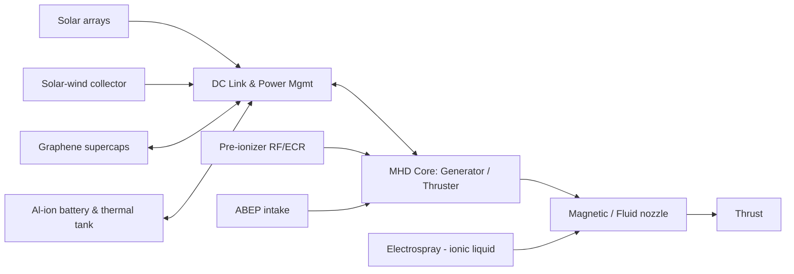
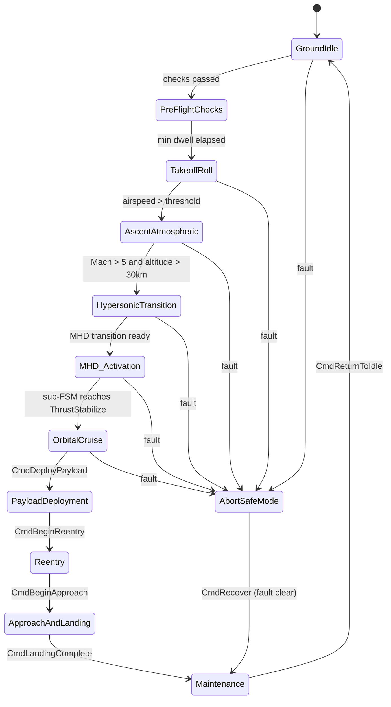
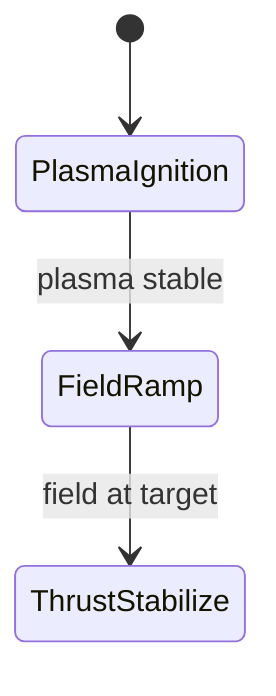

# System Architecture

Same architecture as [`papers/2026-mhd-power-propulsion`](https://github.com/Overby-Industries/whitepapers/tree/main/papers/2026-mhd-power-propulsion)
Section 8 -- reproduced here so it's visible without leaving this repo.

```
 [Solar Arrays]        [Solar Wind Collector]
       |                        |
       v                        v
 +---------------------------------+
 |     DC Link / Power Mgmt        |<---->[Graphene Supercapacitors]
 |     (MPPT, rectifiers)          |<---->[Al-ion Battery / Thermal Tank]
 +---------------------------------+
       ^                        |
       |  (bidirectional)       v
 +-----------------------------------+
 |            MHD Core                |<-- Pre-ionizer (RF/ECR/Arc)
 |  Mode A: Generator  --> DC Link    |
 |  Mode B: Thruster   <-- DC Link    |
 +-----------------------------------+
                  |
          Magnetic / Fluid Nozzle
                  |
      +-----------+------------------+
      | ABEP Inlet (LEO/VLEO)        |  Electrospray Emitter (ionic-liquid)
      +-----------+------------------+
                  v
                Thrust
```



## Flight-phase control (firmware/)

The `ShuttleFSM` in [`firmware/lib/shuttle_fsm`](../firmware/lib/shuttle_fsm)
sequences a vehicle through the phases that use the above power/propulsion
core:





A fault (`ShuttleSensors::faultDetected`) preempts every state above and is
sticky -- recovery out of `AbortSafeMode` is a deliberate, ground-commanded
action, never automatic. See `ShuttleFSM::update()` for the exact logic.

### Ground commands

The arrows labelled `Cmd...` are ground commands, handed to
`ShuttleFSM::command()` once, when they arrive. Every phase change the FSM
cannot decide for itself is one, rather than a sensor threshold, because the
real criteria for those phases do not exist yet and inventing them would put
placeholder physics into a flight sequencer. The flight phases up to
`OrbitalCruise` are still driven by sensor readings through `update()`.

| Command | From | To |
|---|---|---|
| `CmdDeployPayload` | `OrbitalCruise` | `PayloadDeployment` |
| `CmdBeginReentry` | `PayloadDeployment` | `Reentry` |
| `CmdBeginApproach` | `Reentry` | `ApproachAndLanding` |
| `CmdLandingComplete` | `ApproachAndLanding` | `Maintenance` |
| `CmdRecover` | `AbortSafeMode` | `Maintenance` |
| `CmdReturnToIdle` | `Maintenance` | `GroundIdle` |

Each command is valid from **exactly one** state and ignored from the other
eleven, so a repeated or mistimed command does nothing and a caller that holds
one across several ticks cannot carry the vehicle through phases it did not
mean to skip. `command()` returns whether it caused a transition.

**A standing fault outranks the ground.** Nothing is accepted while
`faultDetected` is true, `CmdRecover` included. Recovery over a standing fault
would only abort again on the next `update()`.

**Recovery goes to `Maintenance`, never back into flight,** and from there
`CmdReturnToIdle` returns to `GroundIdle`, where the ordinary preflight entry
applies. A vehicle that has just safed itself is inspected before it is
anything else. Neither step happens on its own: the fault clearing, or a long
quiet period in `Maintenance`, does not move the FSM.

Two of these choices go beyond what the diagram showed and are worth a second
look: that `CmdRecover` lands in `Maintenance`, and that `CmdReturnToIdle`
exists at all (the diagram ended at `Maintenance`).
