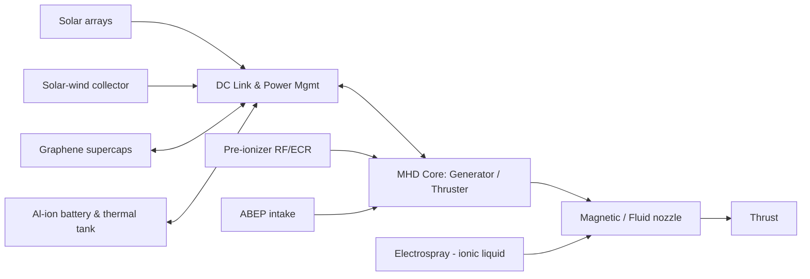
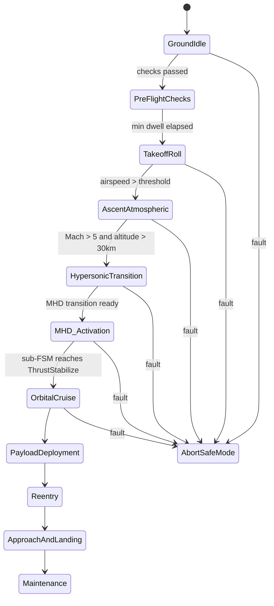
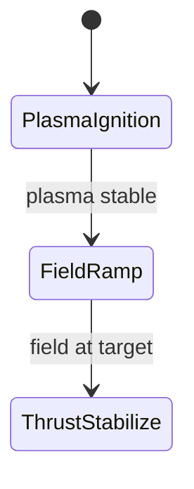

# System Architecture

Same architecture as [`papers/2026-mhd-power-propulsion`](https://github.com/Overby-Industries/whitepapers/tree/main/papers/2026-mhd-power-propulsion)
Section 8 -- reproduced here so it's visible without leaving this repo.

```
 [Solar Arrays]        [Solar Wind Collector]
       |                        |
       v                        v
 +---------------------------------+
 |     DC Link / Power Mgmt        |<---->[Graphene Supercapacitors]
 |     (MPPT, rectifiers)          |<---->[Al-ion Battery / Thermal Tank]
 +---------------------------------+
       ^                        |
       |  (bidirectional)       v
 +-----------------------------------+
 |            MHD Core                |<-- Pre-ionizer (RF/ECR/Arc)
 |  Mode A: Generator  --> DC Link    |
 |  Mode B: Thruster   <-- DC Link    |
 +-----------------------------------+
                  |
          Magnetic / Fluid Nozzle
                  |
      +-----------+------------------+
      | ABEP Inlet (LEO/VLEO)        |  Electrospray Emitter (ionic-liquid)
      +-----------+------------------+
                  v
                Thrust
```



## Flight-phase control (firmware/)

The `ShuttleFSM` in [`firmware/lib/shuttle_fsm`](../firmware/lib/shuttle_fsm)
sequences a vehicle through the phases that use the above power/propulsion
core:





A fault (`ShuttleSensors::faultDetected`) preempts every state above and is
sticky -- recovery out of `AbortSafeMode` is a deliberate, ground-commanded
action, never automatic. See `ShuttleFSM::update()` for the exact logic.
